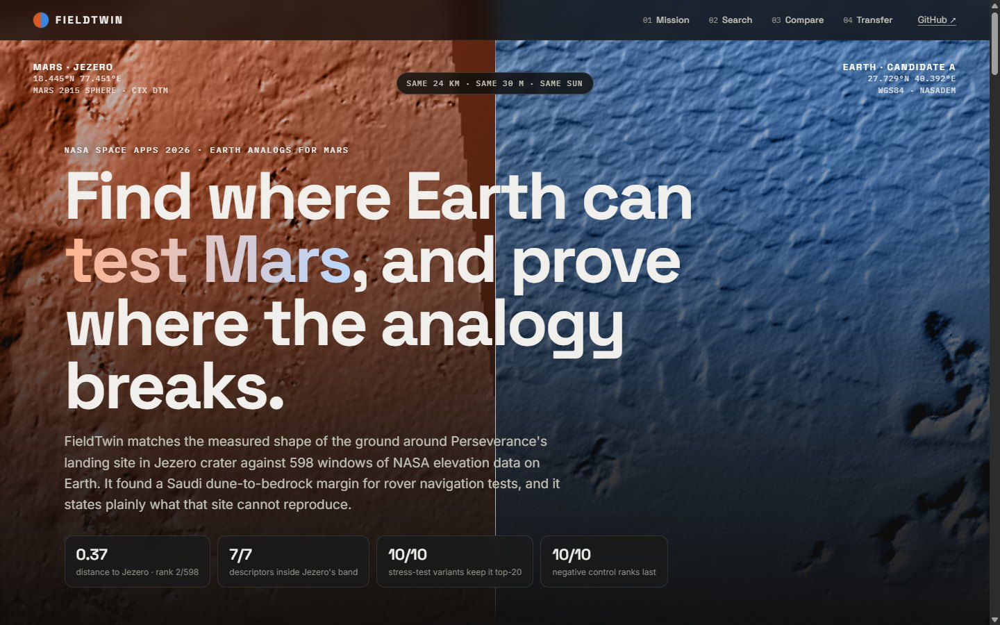
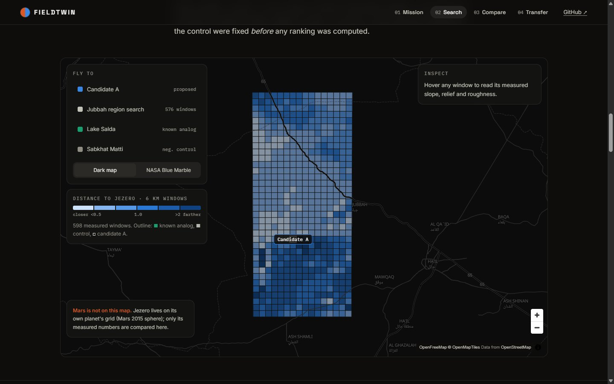
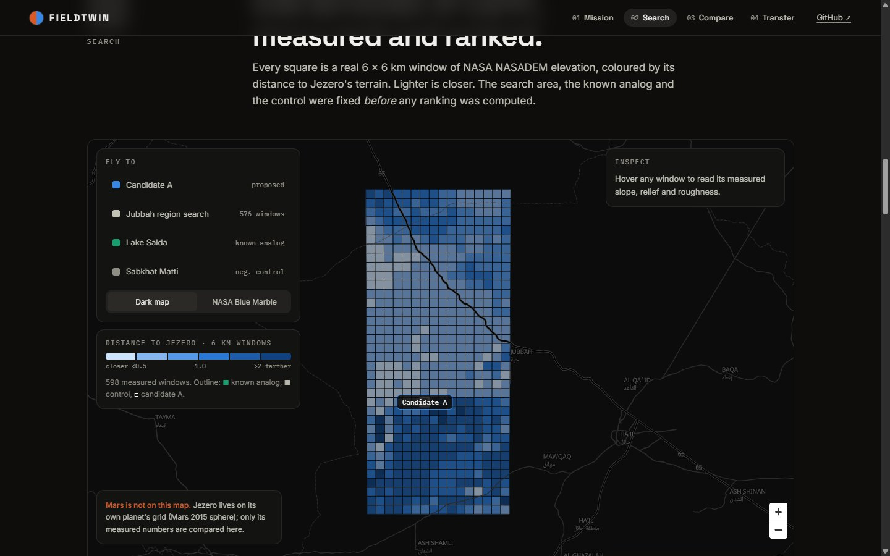
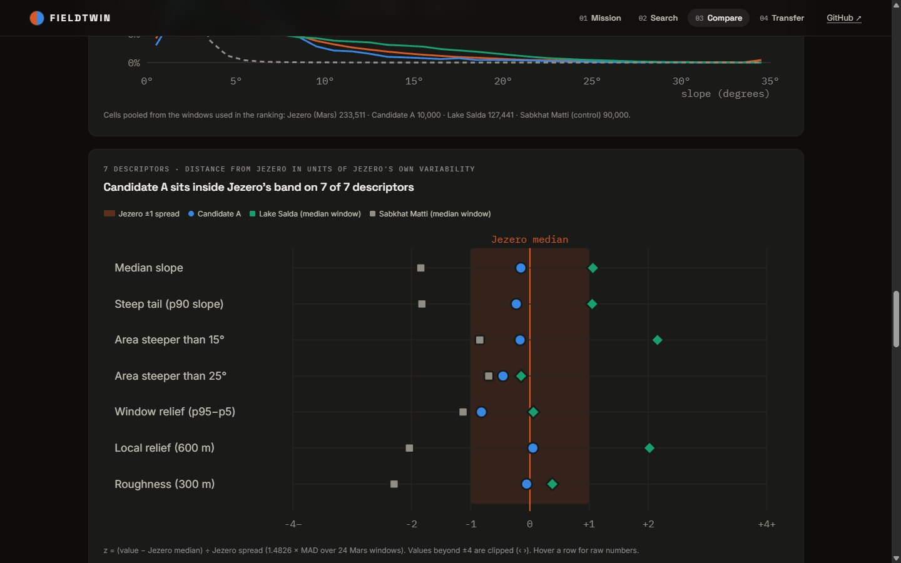

# FieldTwin

*Find where Earth can test Mars, and prove where the analogy breaks.*
NASA Space Apps Challenge 2026: *Identify Earth Locations that Analog the Permanent Moon Base Locations and Mars* (Riyadh local event).

FieldTwin ranks Earth candidate sites for a specific Mars rover mobility/navigation test. It compares measured terrain descriptors (slope, relief, roughness) from a USGS CTX terrain model of Jezero crater (built from MRO CTX images archived in NASA PDS) and NASA NASADEM elevation (NASA Earthdata) at a matched 60 m scale. A known analog and a negative control are ranked alongside the candidates, and the limits of the analogy are documented.

- **Public demo:** GitHub Pages: `https://drmohammedthanoon.github.io/fieldtwin_v02/` (live once the repository is public and Pages is enabled)
- **Submission commit/tag:** _TBD_



| Search map | Compare | Transfer matrix |
|---|---|---|
|  |  |  |

Static fallback screenshots of every chapter are in `docs/img/`.

## Result in one paragraph
Matching the measured terrain of Jezero crater (Perseverance landing area) at 60 m against 598 windows of NASA NASADEM, FieldTwin identifies **candidate A, a Nefud dune-to-bedrock margin at 27.729° N, 40.392° E (Saudi Arabia)**. All 7 descriptors fall inside Jezero's own variability band, it stays in the top 20 under 10/10 sensitivity variants, and the negative control ranks last in 10/10. Proposed use: rover autonomous-navigation tests across a sand-to-bedrock transition. Gravity, atmosphere, radiation and surface material do **not** transfer (see `docs/LIMITATIONS.md`).

## Repository layout
| Path | Purpose |
|---|---|
| `science/` | Python: sources, terrain features, baseline ranking, optional model, evaluation |
| `data/` | `SOURCES.md`, `SEARCH_SCOPE.md`; `raw/` and `processed/` are **not committed** |
| `outputs/validated/` | Small verified JSON/GeoJSON used by the app |
| `app/` | React + TypeScript + Vite + MapLibre frontend |
| `docs/` | Methods, validation, limitations, novelty audit, AI usage, references, demo |
| `tests/` | pytest suite |

## Setup

### Python science environment (Miniforge, all OSes)
Install Miniforge from https://conda-forge.org/download/ (Windows-x86_64, MacOSX-arm64 for Apple Silicon, MacOSX-x86_64 for Intel Mac).

macOS (Terminal) / Windows (Miniforge Prompt):
```
conda env create -f environment.yml
conda activate fieldtwin
python -c "import numpy, pandas, scipy, sklearn, rasterio, geopandas; print('FIELDTWIN_SCIENCE_OK')"
python -m pytest -q
```
In VS Code: *Python: Select Interpreter* → `fieldtwin`.
Windows: if `python` resolves to `WindowsApps`, the environment is not active. Use the Miniforge Prompt.

### Frontend (Node.js LTS)
```
cd app
npm ci
npm run dev      # local preview (copies outputs/validated -> app/public/data first)
npm run build    # production build in app/dist
```
The app only reads the small validated outputs (`outputs/validated/`). It never loads raw DEMs and never puts Mars on an Earth map.
Deployment: `.github/workflows/deploy-pages.yml` builds and publishes `app/dist` to GitHub Pages on every push to `main`.

## Data
Raw data is not stored in Git. See `data/SOURCES.md` for exact product/granule IDs, URLs/DOIs and checksums to re-download. Primary sources are NASA PDS (Mars) and NASA Earthdata Search (Earth).

## Reproduce
1. Fresh clone → `conda env create -f environment.yml`
2. Download the products listed in `data/SOURCES.md` into `data/raw/`
3. `python -m science.run_baseline && python -m science.evaluate && python -m science.site_card && python -m science.figures` → writes `outputs/validated/`
4. `python -m pytest -q`
5. `cd app && npm ci && npm run build`

## License
See `LICENSE`. Third-party data keeps its original license and citation (see `docs/REFERENCES.md`).
